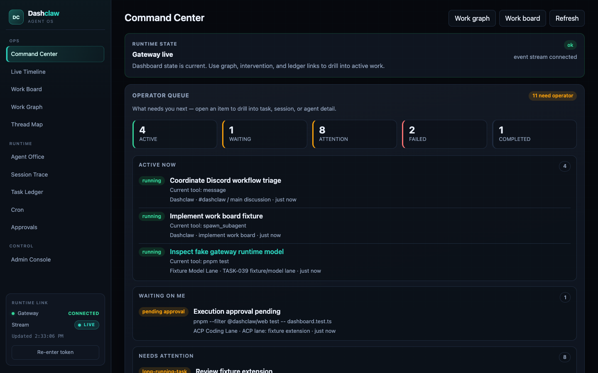

# Dashclaw

Agent OS runtime cockpit for OpenClaw. Dashclaw connects to a local OpenClaw Gateway over the official WebSocket protocol and provides real-time observability, persistent timeline history, and guarded admin controls.



## Why Dashclaw?

- **See what is happening now** — connect agents, sessions, tasks, approvals,
  failures, and recent events in one operational view.
- **Find work that needs intervention** — surface blocked, failed, stale, and
  approval-bound activity without joining raw Gateway data by hand.
- **Act with guardrails** — inspect runtime history and use allowlisted admin
  operations with confirmation, audit logging, redaction, and read-only mode.

Dashclaw v0.1.0 is distributed as source code. It has been tested on Linux and
macOS with OpenClaw v2026.6.11. Windows is experimental: use loopback binding
and restrict `.env` and the data directory with Windows ACLs.

## Prerequisites

- Git
- Node.js 22 or newer
- Corepack with the repository-pinned pnpm 10.34.0
- OpenClaw v2026.6.11 for live Gateway integration, or the built-in fake Gateway

## Quick start

```bash
git clone https://github.com/savva312/dashclaw.git
cd dashclaw
corepack enable
pnpm install
cp .env.example .env
chmod 600 .env
pnpm build

# Terminal 1 — server (reads repo-root .env)
pnpm --filter @dashclaw/server dev

# Terminal 2 — web UI (reads repo-root .env)
pnpm --filter @dashclaw/web dev
```

Open http://localhost:5173 in **dev** (Vite + hot reload), then enter the dashboard token printed by the server. If `DASHCLAW_TOKEN` is set in `.env`, enter that value in the login screen. The browser keeps it in `sessionStorage` for the current tab; dashboard tokens must never be configured through a `VITE_*` variable.

### Production (single port)

The source release includes no prebuilt binary, container, or service unit.
After installing dependencies, the server builds and serves the UI from the
same port as the API:

```bash
pnpm start
# open http://127.0.0.1:8090
```

Set `DASHCLAW_SERVE_WEB=0` to run API-only. Override UI path with `DASHCLAW_WEB_DIST`.
For unattended or non-loopback use, configure a unique `DASHCLAW_TOKEN` of at
least 32 non-whitespace characters. Non-loopback binding fails closed when no
token is configured.

## Live OpenClaw integration

```bash
export OPENCLAW_GATEWAY_URL=ws://127.0.0.1:18789
export OPENCLAW_GATEWAY_TOKEN=your-gateway-token
export DASHCLAW_TOKEN=your-dashboard-token

pnpm --filter @dashclaw/server dev
pnpm --filter @dashclaw/web dev
```

Ensure the Gateway is running (`openclaw gateway status`).

### Remote gateway (SSH port forward)

If your OpenClaw Gateway runs on another machine, the easiest way to connect is to forward its port over SSH. Dashclaw defaults to `ws://127.0.0.1:18789`, so once the tunnel is up you can leave `OPENCLAW_GATEWAY_URL` unchanged.

Add a host entry to `~/.ssh/config`:

```
Host openclaw
  HostName <host>
  User <user>
  IdentityFile <path-to-key>
  IdentitiesOnly yes
  LocalForward 18789 127.0.0.1:18789
```

Open the tunnel:

```bash
ssh openclaw
```

With the SSH session running, start Dashclaw locally as usual. Traffic to `127.0.0.1:18789` is forwarded to the remote gateway. Set `OPENCLAW_GATEWAY_TOKEN` to the token from the remote host.

Direct connections to non-loopback Gateways must use `wss://`. Plaintext remote
`ws://` is rejected unless `OPENCLAW_GATEWAY_ALLOW_INSECURE=1` is set. That
override disables transport confidentiality and should be limited to trusted,
isolated networks. Credentials embedded in `OPENCLAW_GATEWAY_URL` are always
rejected; use `OPENCLAW_GATEWAY_TOKEN` or `OPENCLAW_GATEWAY_PASSWORD` instead.
Loopback `ws://` connections, including the SSH tunnel above, remain supported.

## Architecture

- `apps/server` — Gateway bridge, SQLite runtime store, SSE API, admin RPC proxy
- `apps/web` — Agent OS UI built with **Clawdeck** (custom design system), TanStack Query, React Router
- `packages/openclaw-gateway` — Gateway WebSocket client + fake gateway for tests
- `packages/runtime-model` — shared types, RPC allowlists, redaction helpers

## OpenClaw integration

Dashclaw talks to OpenClaw over the **Gateway WebSocket protocol** (not by reading `~/.openclaw` files).

1. Server opens `OPENCLAW_GATEWAY_URL` (default `ws://127.0.0.1:18789`).
2. Gateway sends `connect.challenge`; server responds with operator auth.
3. Gateway returns `hello-ok`; server polls RPCs and subscribes to pushed events.

**Read RPCs (v0):** `health`, `agents.list`, `sessions.list`, `sessions.preview`, `tasks.list`, `cron.list`, `cron.runs`, `node.list`, `exec.approval.list`, `logs.tail`

**Write RPCs (Admin Console):** `sessions.abort`, `cron.run`, `exec.approval.resolve`, `tools.invoke`, `config.set`, `gateway.restart.request`, and others in the allowlist.

**Events:** `agent`, `session.message`, `session.operation`, `session.tool`, `sessions.changed`, `cron`, `health`, `presence`, `heartbeat`, `exec.approval.requested`, `exec.approval.resolved`, `shutdown`

Gateway events are not replayed; on sequence gaps Dashclaw refreshes snapshot via RPC. Dashclaw v0.1.0 is tested against OpenClaw v2026.6.11. Other versions may change RPC or event contracts; pin your OpenClaw installation and recheck the [Gateway protocol docs](https://docs.openclaw.ai/gateway/protocol) when upgrading.

Set `DASHCLAW_FAKE_GATEWAY=1` to use an in-process mock Gateway without a live OpenClaw install. Add `DASHCLAW_FAKE_GATEWAY_SCENARIO=idle|busy|failed|approval-heavy|approval-cockpit|degraded|discord-workflow|session-pagination|task-contract` to drive repeatable dashboard states, including multi-page discovery and live-shaped task telemetry.

## Admin safety

Admin-capable Gateway RPCs go through a guarded proxy:

1. **Dashboard auth** — Bearer token (`DASHCLAW_TOKEN`) on all routes except `/api/health`.
2. **RPC allowlist** — Only `READ_RPC_METHODS` / `WRITE_RPC_METHODS` are permitted.
3. **High-risk confirmation** — Execution-capable and configuration RPCs require a short-lived, single-use confirm token from `POST /api/admin/confirm`, bound to the server-issued dashboard session, method, and exact canonical parameters. Confirmation prevents accidental actions; it is not a second authentication factor and provides no protection after the dashboard credential and session are compromised.
4. **Audit log** — RPCs are persisted with a server-issued `dashboard-session:<uuid>` attribution, method, redacted params, and result summary. Because dashboard auth uses one shared bearer token, this identifies a browser/API session, not a human.
5. **Safe output boundary** — Authorization and cookie values, credentials, private/cloud/API keys, passwords, secrets, and session tokens are redacted before SQLite persistence, API/SSE output, audit logging, previews, or admin result display. Key matching is case-insensitive and ignores common separators.

Recursive/raw output is bounded to 8 object levels, 50 keys or array items per container, 1,000 total values, and 10,000 characters per string. Allowlisted snapshot collections are separately capped at 200 agents and 500 entries per other collection; session previews are capped at 25 previews with 50 items each. Circular, accessor, exotic, and prototype-mutation inputs are replaced or omitted rather than traversed. Snapshot, timeline, audit, and session-preview outputs use allowlisted shapes; other allowlisted Gateway RPC results use the bounded recursive boundary. Redaction is pattern-based and is not encryption or a substitute for avoiding credentials in operational text.

Set `DASHCLAW_READ_ONLY=1` for an observation-only deployment. In this mode Dashclaw requests only the Gateway `operator.read` scope, does not register admin confirmation or RPC write routes, and rejects write RPCs in the server and Gateway bridge.

Defaults: bind `127.0.0.1` only; gateway token stays server-side. Do not expose Dashclaw on public networks without TLS and stronger auth.

## Scripts

| Command | Description |
|---------|-------------|
| `pnpm dev` | Run server + web in parallel (two ports) |
| `pnpm start` | Build all packages and run server with bundled UI |
| `pnpm build` | Build all packages |
| `pnpm test` | Run unit/integration tests |
| `pnpm typecheck` | Typecheck all packages |
| `pnpm lint` | Lint all source and test files |
| `pnpm test:e2e` | Run the Playwright browser suite |

## Environment

Configuration lives in the **repo root** `.env` file (copy from `.env.example`). Optional `.env.local` overrides `.env` and is gitignored.

| Variable | Default | Description |
|----------|---------|-------------|
| `DASHCLAW_PORT` | `8090` | Server HTTP port |
| `DASHCLAW_BIND` | `127.0.0.1` | Server bind address |
| `DASHCLAW_TOKEN` | random token on loopback | Dashboard auth token; configured values require at least 32 non-whitespace characters and are mandatory for non-loopback binds |
| `DASHCLAW_DB` | `./data/dashclaw.db` | SQLite database path |
| `DASHCLAW_READ_ONLY` | — | Set `1` to omit admin write routes and request only Gateway read scope |
| `OPENCLAW_GATEWAY_URL` | `ws://127.0.0.1:18789` | Gateway WebSocket URL |
| `OPENCLAW_GATEWAY_TOKEN` | — | Gateway auth token |
| `OPENCLAW_GATEWAY_PASSWORD` | — | Gateway password fallback used only when `OPENCLAW_GATEWAY_TOKEN` is unset |
| `OPENCLAW_GATEWAY_ALLOW_INSECURE` | — | Set `1` to explicitly allow remote plaintext `ws://` (unsafe) |
| `DASHCLAW_FAKE_GATEWAY` | — | Set `1` to use in-process fake gateway |
| `DASHCLAW_FAKE_GATEWAY_SCENARIO` | `busy` | Fake gateway scenario, including `session-pagination` and `task-contract` contract fixtures |
| `DASHCLAW_SERVE_WEB` | auto | Set `0` to disable bundled UI in production |
| `DASHCLAW_WEB_DIST` | `apps/web/dist` | Path to built web assets |
| `VITE_PORT` | `5173` | Web dev server port |
| `VITE_DASHCLAW_API_URL` | `http://127.0.0.1:$DASHCLAW_PORT` | API proxy target for web dev |

`DASHCLAW_TOKEN` is server-only. Variables prefixed with `VITE_` are public browser configuration and must not contain credentials.

### Local data security

On POSIX systems, Dashclaw creates or corrects the database parent directory to
mode `0700` and the SQLite database, WAL, and SHM files to mode `0600`. Existing
database contents are preserved. A custom `DASHCLAW_DB` must therefore use a
dedicated directory owned by the account running Dashclaw; symbolic-link
directories/files, non-regular database targets, filesystem roots, and shared
sticky directories such as `/tmp` are rejected.

Environment files can contain dashboard and Gateway credentials. Keep both
supported files owner-only:

```bash
chmod 600 .env .env.local
```

Database backups contain the same sensitive runtime history. Store each backup
in an owner-only directory and apply `chmod 600` to copied database and sidecar
files. Stop Dashclaw before a file-level copy, or use SQLite-compatible backup
tooling, so the database and sidecars remain consistent. These file permissions
limit access by other local accounts but do not encrypt the database or its
backups.

Windows does not enforce POSIX modes. Dashclaw emits a warning and continues
only for a loopback bind; a non-loopback bind fails closed. Restrict the data
directory and environment files with Windows ACLs before use.

### Upgrading and backing up

Before upgrading, stop Dashclaw and back up `.env` plus the SQLite database and
its `-wal`/`-shm` sidecars into an owner-only directory. Pull the intended
release tag, run `pnpm install --frozen-lockfile`, then `pnpm build` and restart.
Dashclaw prunes runtime history to documented limits; see
[`docs/runtime-limits.md`](docs/runtime-limits.md). To uninstall, stop Dashclaw
and remove the checkout. Delete the data directory separately only if its
timeline and audit history are no longer needed.

## Support and contributing

Use [GitHub Issues](https://github.com/savva312/dashclaw/issues) for reproducible
bugs and feature requests. Read [SUPPORT.md](SUPPORT.md) for support boundaries,
[CONTRIBUTING.md](CONTRIBUTING.md) before submitting changes, and [SECURITY.md](SECURITY.md)
for private vulnerability reporting.

## Feedback

Running Dashclaw with a real OpenClaw workflow? Share your setup experience,
the first confusing screen, missing operational signals, and anything you would
use weekly in the [v0.1 feedback discussion](https://github.com/savva312/dashclaw/discussions/16).
Include your Dashclaw version, OpenClaw version, and operating system, but never
post credentials, private session output, environment files, or database data.

## License

[MIT](LICENSE)

Dashclaw is an independent project and is not affiliated with or endorsed by
OpenClaw or Discord. OpenClaw, Discord, and other names are trademarks of their
respective owners. Clawdeck is Dashclaw's custom design system.
